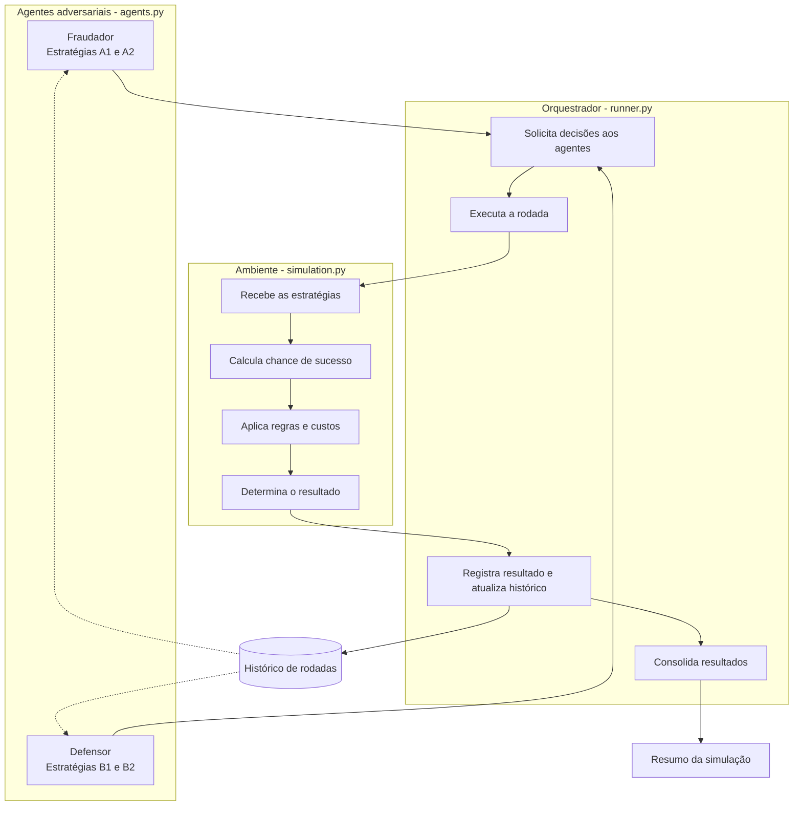
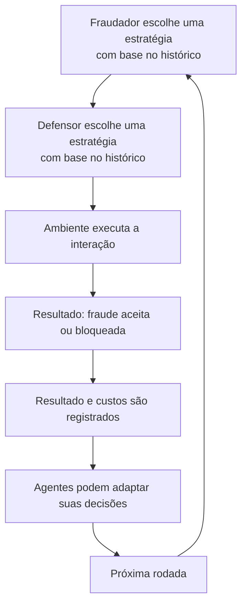

# Trabalho 2 — Sistema Adversarial com Agentes

## Objetivo

Implementar uma simulação de interação adversarial entre dois agentes com objetivos conflitantes: um Fraudador, que busca obter benefícios por meio de fraude no uso de um cupom promocional, e um Defensor, que busca impedir as fraudes e controlar os custos da proteção.

A proposta é observar como as decisões de cada agente influenciam os resultados e como as estratégias podem mudar ao longo de várias rodadas, a partir do histórico das interações.

## Cenário

A simulação representa uma loja virtual fictícia que disponibiliza o cupom `PRIMEIRACOMPRA10`, destinado a uma única utilização por cliente.

- **Fraudador:** tenta obter novas utilizações indevidas do cupom.
- **Defensor:** aplica mecanismos de validação para identificar e bloquear tentativas fraudulentas.
- **Ambiente:** verifica as regras, calcula a chance de sucesso, registra o resultado e contabiliza benefícios e custos.

O cenário é apenas uma simulação acadêmica, sem interação com uma loja real.

## Agentes e estratégias

O projeto possui dois agentes, com objetivos diferentes:

### Fraudador

- **A1 — Simples:** realiza uma tentativa com menor capacidade de contornar a defesa.
- **A2 — Adaptativa:** altera sua abordagem com base nos resultados anteriores, buscando aumentar a chance de sucesso.

### Defensor

- **B1 — Básica:** utiliza uma validação mais simples, com menor custo operacional.
- **B2 — Reforçada:** aplica validações adicionais, aumentando a capacidade de detecção, mas também os custos e o atrito para clientes legítimos.

As probabilidades de sucesso e os custos utilizados são parâmetros definidos para os experimentos da simulação, não dados empíricos de uma loja real.

## Arquitetura

O sistema está organizado em três componentes principais:

- `agents.py`: contém os agentes e suas regras de decisão.
- `simulation.py`: representa o ambiente, aplica as regras, calcula os resultados e atualiza o histórico.
- `runner.py`: coordena as decisões dos agentes e a execução das rodadas.



## Funcionamento das rodadas

Cada rodada representa uma interação entre os agentes:



O histórico permite que os agentes alterem suas escolhas ao longo da execução. Por exemplo, o Fraudador pode adotar a estratégia A2 após uma tentativa bloqueada, enquanto o Defensor pode reforçar ou reduzir sua proteção conforme os resultados e custos observados.

## Resultados registrados

A simulação registra informações como:

- estratégias escolhidas pelos agentes;
- motivo das decisões;
- probabilidade de sucesso da tentativa;
- resultado da interação;
- utilização do cupom;
- fraudes aceitas e bloqueadas;
- custos operacionais e de atrito;
- benefícios e utilidades dos agentes.

## Como executar

Execute os comandos a partir da pasta `Trabalho-2`, com o ambiente Python configurado.

### Executar a simulação

```bash
python runner.py
```

### Executar os testes

```bash
python test_simulation.py
```

## Estado atual

### Agente fraudador com Agno (integrante 2)

`fraudador_agno.py` implementa `AgenteFraudadorAgno`, compatível com
`escolher_acao(historico) -> str` do runner. O modelo retorna uma
`DecisaoFraudador` validada pelo Pydantic: estratégia `A1` ou `A2` e motivo
não vazio. A implementação usa `Agent.run` e `output_schema` conforme a
[documentação do Agno](https://docs.agno.com/models/providers/native/anthropic/overview).

O objetivo é maximizar o benefício acumulado. O agente recebe o histórico de
suas ações, resgates e utilidades; não recebe a defesa, probabilidades internas
ou regras do defensor. As instruções propõem explorar A1 inicialmente e avaliar
manutenção ou mudança a partir dos resultados. A decisão posterior é do modelo,
sem sequência fixa de rodadas. A memória é o histórico fornecido pelo ambiente.
Cada nova conta na demonstração pertence ao mesmo fraudador fictício.

Instale as dependências em um ambiente virtual (Python 3.11 ou superior),
a partir de `Trabalho-2`:

```bash
python3 -m venv .venv
source .venv/bin/activate
python -m pip install -r requirements.txt
export ANTHROPIC_API_KEY="sua-chave"
python demo_fraudador.py --rodadas 10 --seed 42
```

A execução usa a API da Anthropic (Claude) e pode gerar cobrança. Configure a chave apenas
no ambiente local; não a inclua nos commits. O modelo padrão é `claude-haiku-4-5-20251001`;
para trocar, use `--modelo` ou a variável `FRAUDADOR_MODEL` com um modelo
compatível com saída estruturada. Arquivos `.env` não são carregados automaticamente.

`demo_fraudador.py` conecta o fraudador ao defensor baseado em regras usando
o runner existente. Salva em `evidencias/fraudador.json` as observações, decisões,
justificativas, mudanças de estratégia, resultados e resumo. Use `--saida` para
guardar execuções em arquivos distintos. A pasta de evidências é ignorada pelo
Git; selecione e revise os resultados que serão incluídos na entrega.

Para integrar o agente em outro orquestrador:

```python
from fraudador_agno import AgenteFraudadorAgno

fraudador = AgenteFraudadorAgno()
# Passe fraudador para executar_simulacao junto do ambiente e do defensor.
```

Para executar todos os testes, incluindo os novos testes sem chamadas à API:

```bash
python -m unittest discover -v
```

Os testes usam um substituto controlado do modelo para verificar transmissão
do histórico, mudança após bloqueio, validação, isolamento de informações e
propagação de falhas. Eles não comprovam a adaptação do LLM real. Para essa
evidência, execute a demonstração e examine se o motivo cita resultados anteriores
e se a escolha muda em resposta a eles. Não há garantia de mudança em toda execução;
a seed controla apenas o ambiente, não as respostas do modelo.

Limitações: A2 não tem custo adicional e possui maior chance de sucesso no
ambiente atual, podendo levar à estabilização nessa escolha. O defensor ainda
usa regras. O histórico completo cresce a cada rodada e este protótipo destina-se
a execuções curtas. Erros de API ou respostas inválidas interrompem a execução,
sem substituir silenciosamente a IA por regras; o arquivo é salvo somente após
a conclusão das rodadas.

O ambiente de simulação, os primeiros agentes baseados em regras e o orquestrador já foram implementados.

Os testes automatizados foram executados com sucesso, e uma simulação de dez rodadas demonstrou a adaptação das estratégias ao longo da interação.

## Próximos passos

1. **Completar a integração com Agno:** implementar o defensor com IA e conectá-lo ao fraudador já disponível.
2. **Testar a integração:** verificar se os agentes conseguem interagir durante várias rodadas, observar os resultados anteriores e modificar suas decisões.
3. **Realizar experimentos:** executar diferentes simulações e comparar os resultados dos agentes baseados em regras com os agentes que utilizam IA.
4. **Finalizar a documentação e a demonstração:** organizar os resultados e preparar uma execução completa do sistema para apresentação.
