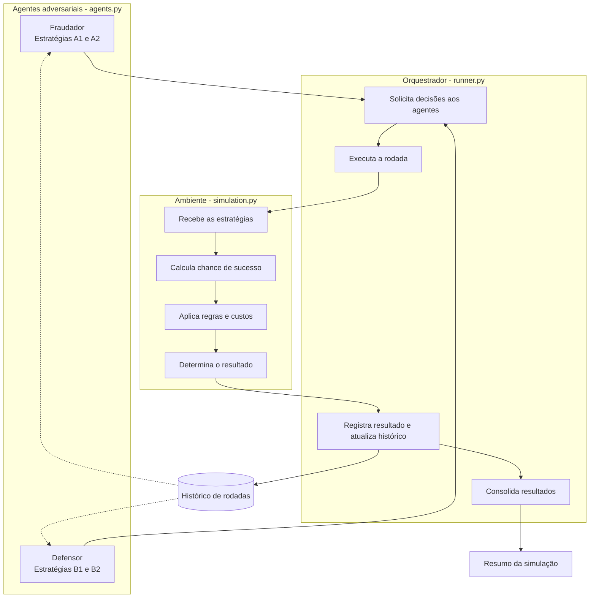
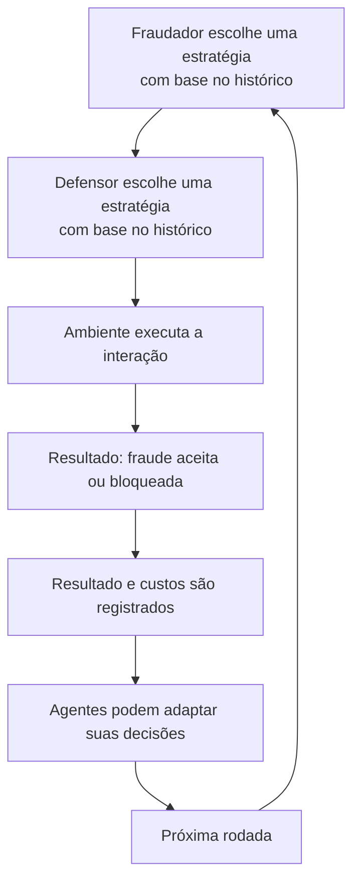

# Trabalho 2 — Sistema Adversarial com Agentes

## Objetivo

Implementar uma simulação de interação adversarial entre dois agentes com objetivos conflitantes: um Fraudador, que busca obter benefícios por meio de fraude no uso de um cupom promocional, e um Defensor, que busca impedir as fraudes e controlar os custos da proteção.

A proposta é observar como as decisões de cada agente influenciam os resultados e como as estratégias podem mudar ao longo de várias rodadas, a partir do histórico das interações.

## Cenário

A simulação representa uma loja virtual fictícia que disponibiliza o cupom `PRIMEIRACOMPRA10`, destinado a uma única utilização por cliente.

- **Fraudador:** tenta obter novas utilizações indevidas do cupom.
- **Defensor:** aplica mecanismos de validação para identificar e bloquear tentativas fraudulentas.
- **Ambiente:** verifica as regras, calcula a chance de sucesso, registra o resultado e contabiliza benefícios e custos.

O cenário é apenas uma simulação acadêmica, sem interação com uma loja real.

## Agentes e estratégias

O projeto possui dois agentes, com objetivos diferentes:

### Fraudador

- **A1 — Simples:** realiza uma tentativa com menor capacidade de contornar a defesa.
- **A2 — Adaptativa:** altera sua abordagem com base nos resultados anteriores, buscando aumentar a chance de sucesso.

### Defensor

- **B1 — Básica:** utiliza uma validação mais simples, com menor custo operacional.
- **B2 — Reforçada:** aplica validações adicionais, aumentando a capacidade de detecção, mas também os custos e o atrito para clientes legítimos.

As probabilidades de sucesso e os custos utilizados são parâmetros definidos para os experimentos da simulação, não dados empíricos de uma loja real.

## Arquitetura

O sistema está organizado em três componentes principais:

- `agents.py`: contém os agentes e suas regras de decisão.
- `simulation.py`: representa o ambiente, aplica as regras, calcula os resultados e atualiza o histórico.
- `runner.py`: coordena as decisões dos agentes e a execução das rodadas.



## Funcionamento das rodadas

Cada rodada representa uma interação entre os agentes:



O histórico permite que os agentes alterem suas escolhas ao longo da execução. Por exemplo, o Fraudador pode adotar a estratégia A2 após uma tentativa bloqueada, enquanto o Defensor pode reforçar ou reduzir sua proteção conforme os resultados e custos observados.

## Resultados registrados

A simulação registra informações como:

- estratégias escolhidas pelos agentes;
- motivo das decisões;
- probabilidade de sucesso da tentativa;
- resultado da interação;
- utilização do cupom;
- fraudes aceitas e bloqueadas;
- custos operacionais e de atrito;
- benefícios e utilidades dos agentes.

## Como executar

Execute os comandos a partir da pasta `Trabalho-2`, com o ambiente Python configurado.

### Executar a simulação

```bash
python runner.py
```

### Executar os testes

```bash
python test_simulation.py
```

## Estado atual

O ambiente de simulação, os primeiros agentes baseados em regras e o orquestrador já foram implementados.

Os testes automatizados foram executados com sucesso, e uma simulação de dez rodadas demonstrou a adaptação das estratégias ao longo da interação.

## Próximos passos

1. **Integrar o Agno:** substituir as decisões baseadas somente em regras por agentes que utilizem modelos de IA para escolher suas estratégias com base no histórico.
2. **Testar a integração:** verificar se os agentes conseguem interagir durante várias rodadas, observar os resultados anteriores e modificar suas decisões.
3. **Realizar experimentos:** executar diferentes simulações e comparar os resultados dos agentes baseados em regras com os agentes que utilizam IA.
4. **Finalizar a documentação e a demonstração:** organizar os resultados e preparar uma execução completa do sistema para apresentação.
