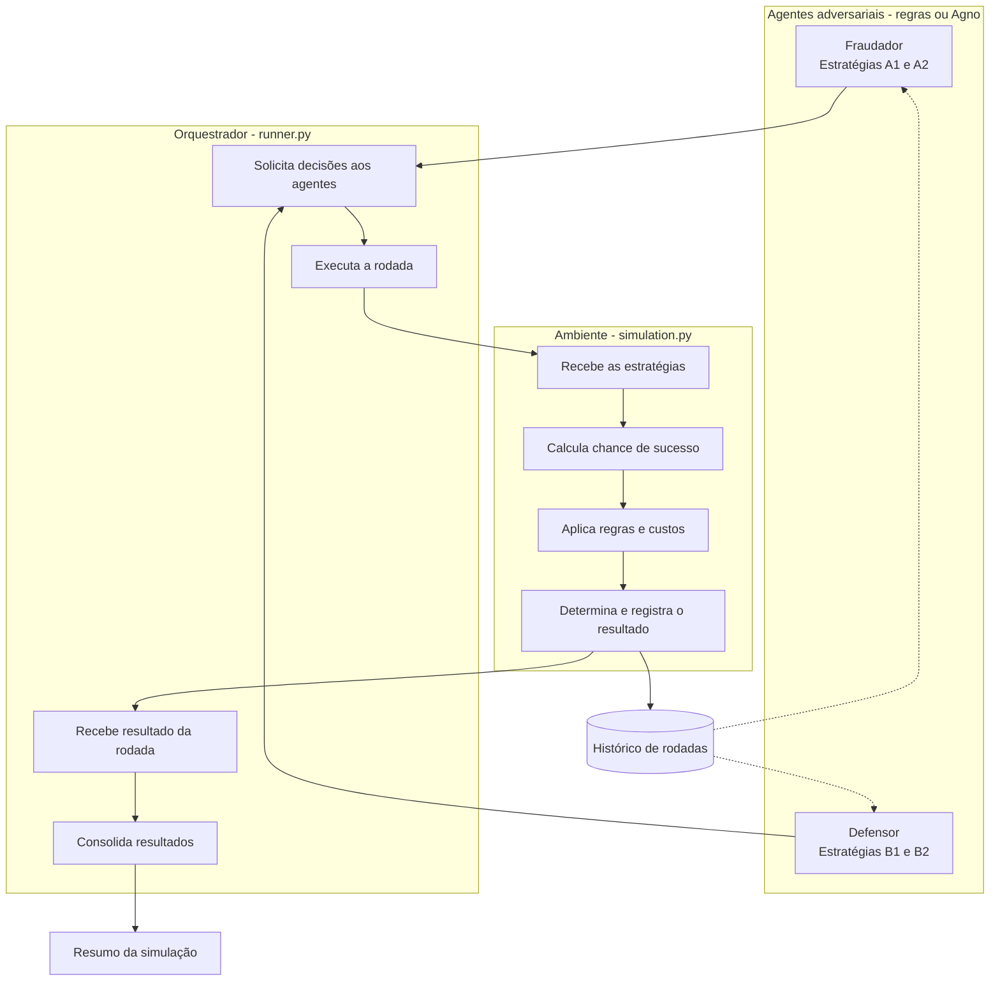
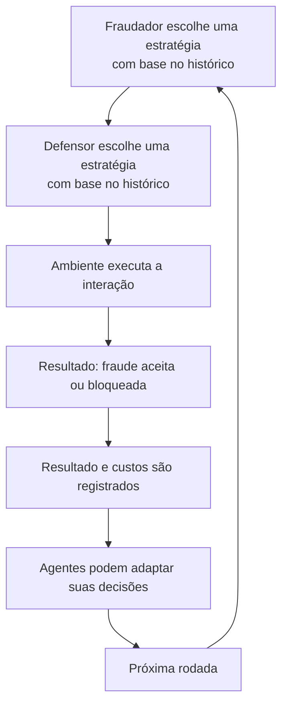

# Trabalho 2 — Sistema Adversarial com Agentes

## Objetivo

Implementar uma simulação de interação adversarial entre dois agentes com objetivos conflitantes: um Fraudador, que busca obter benefícios por meio de fraude no uso de um cupom promocional, e um Defensor, que busca impedir as fraudes e controlar os custos da proteção.

A proposta é observar como as decisões de cada agente influenciam os resultados e como as estratégias podem mudar ao longo de várias rodadas, a partir do histórico das interações.

## Cenário

A simulação representa uma loja virtual fictícia que disponibiliza o cupom `PRIMEIRACOMPRA10`, destinado a uma única utilização por cliente.

- **Fraudador:** tenta obter novas utilizações indevidas do cupom.
- **Defensor:** aplica mecanismos de validação para identificar e bloquear tentativas fraudulentas.
- **Ambiente:** verifica as regras, calcula a chance de sucesso, registra o resultado e contabiliza benefícios e custos.

O cenário é apenas uma simulação acadêmica, sem interação com uma loja real.

## Agentes e estratégias

O projeto possui dois agentes, com objetivos diferentes:

### Fraudador

- **A1 — Simples:** realiza uma tentativa com menor capacidade de contornar a defesa.
- **A2 — Alternativa/adaptativa:** representa uma tentativa com maior capacidade de contornar a defesa. A decisão de mudar entre A1 e A2 cabe ao agente, com base no histórico.

### Defensor

- **B1 — Básica:** utiliza uma validação mais simples, com menor custo operacional.
- **B2 — Reforçada:** aplica validações adicionais, aumentando a capacidade de detecção, mas também os custos e o atrito para clientes legítimos.

As probabilidades de sucesso e os custos utilizados são parâmetros definidos para os experimentos da simulação, não dados empíricos de uma loja real.

## Modelo implementado

Cada rodada do runner usa uma nova conta fictícia do mesmo fraudador. Os sinais de identidade e os controles antifraude são abstraídos pelas probabilidades abaixo; não há operação contra uma loja real.

| Ataque | Defesa | Probabilidade de resgate | Utilidade esperada do fraudador | Utilidade esperada do defensor |
|---|---|---:|---:|---:|
| A1 | B1 | 70% | 7 | −5 |
| A1 | B2 | 10% | 1 | −3 |
| A2 | B1 | 80% | 8 | −7 |
| A2 | B2 | 35% | 3,5 | −8 |

O cupom vale 10 unidades econômicas fixas. B1 custa 1 de operação e 0 de fricção; B2 custa 3 de operação e 8 de fricção. A2 não tem custo adicional. Com `S = 1` para resgate e `S = 0` para bloqueio, e `C` igual ao custo da defesa:

```text
Utilidade do fraudador = 10 × S
Utilidade do defensor = 10 × (1 − S) − (C + 10 × S)
E[utilidade do fraudador] = 10p
E[utilidade do defensor] = 10 − 20p − C
```

O benefício de 10 atribuído ao defensor quando há bloqueio representa uma fraude evitada, não uma receita. O custo total do sistema é `C + 10 × S` e deve ser distinguido da utilidade do defensor.

Nesse modelo, A2 é estritamente dominante para o fraudador. A melhor resposta do defensor é B2 contra A1 e B1 contra A2; o equilíbrio estático em utilidades esperadas é **(A2, B1)**. A análise completa está na [seção 2 do README principal](../README.md#2-modelo-estratégico-estático). A matriz descreve contas novas; um identificador que já resgatou o cupom tem probabilidade zero de novo resgate.

O ambiente não simula clientes legítimos: a fricção é uma penalidade fixa, e não uma medição de falsos positivos ou abandono. Os agentes não têm garantia de convergir ao equilíbrio em uma execução curta.

## Arquitetura

O sistema separa agentes, ambiente e orquestração:

- `agents.py`: contém os dois agentes baseados em regras.
- `fraudador_agno.py` e `defensor_agno.py`: implementam os dois agentes de IA, com respostas validadas pelo Pydantic.
- `simulation.py`: representa o ambiente, aplica as regras, calcula os resultados e atualiza o histórico.
- `runner.py`: coordena as decisões dos agentes e a execução das rodadas.
- `demo_fraudador.py`: executa o fraudador de IA contra o defensor por regras.
- `demo_agentes.py`: executa os dois agentes de IA e exporta as evidências de ambos.



## Funcionamento das rodadas

Cada rodada representa uma interação entre os agentes:



O histórico permite que os agentes alterem suas escolhas ao longo da execução. Por exemplo, o Fraudador pode adotar a estratégia A2 após uma tentativa bloqueada, enquanto o Defensor pode reforçar ou reduzir sua proteção conforme os resultados e custos observados.

Os dois agentes decidem com o histórico anterior à rodada: o defensor não recebe o ataque escolhido na rodada atual. O ambiente gera os identificadores das novas contas, evitando colisões inclusive com identificadores informados manualmente. Chamadas sucessivas de `executar_simulacao` no mesmo ambiente acrescentam rodadas, continuam a numeração e retornam um resumo de todo o histórico acumulado. Para iniciar um experimento independente, crie um novo ambiente e novos agentes.

## Resultados registrados

A simulação registra informações como:

- estratégias escolhidas pelos agentes;
- motivos das decisões (exibidos pelo runner e exportados pelas demonstrações de IA);
- probabilidade de sucesso da tentativa;
- resultado da interação;
- utilização do cupom;
- fraudes aceitas e bloqueadas;
- custos operacionais e de atrito;
- benefícios e utilidades dos agentes.

## Como executar

Execute os comandos a partir da pasta `Trabalho-2`. Use Python 3.11 ou superior.

### Simulação com regras, sem API

```bash
python3 runner.py
```

Essa execução usa apenas a biblioteca padrão do Python e dez rodadas com seed 42.

### Preparar os agentes de IA

```bash
python3 -m venv .venv
source .venv/bin/activate
python -m pip install -r requirements.txt
export ANTHROPIC_API_KEY="sua-chave"
```

As demonstrações de IA usam a API da Anthropic e podem gerar cobrança. A chave deve ficar no ambiente local; arquivos `.env` não são carregados automaticamente.

### Executar os dois agentes de IA

```bash
python demo_agentes.py --rodadas 10 --seed 42 --saida evidencias/agentes-seed42.json
```

O modelo padrão dos dois agentes é `claude-haiku-4-5-20251001`. Para configurar cada um, use `--modelo-fraudador` e `--modelo-defensor`, ou as variáveis `FRAUDADOR_MODEL` e `DEFENSOR_MODEL`. O argumento de linha de comando tem prioridade sobre a variável de ambiente. A demonstração exige pelo menos três rodadas.

Sem `--saida`, o arquivo é salvo em `evidencias/agentes.json`. Ele contém:

- status `concluida` ou `interrompida`, seed, número de rodadas solicitadas e modelos utilizados;
- observações, decisões, motivos e mudanças de estratégia de ambos os agentes;
- histórico das rodadas concluídas e resumo dos resultados econômicos.

Se uma chamada à API falhar ou retornar uma resposta inválida durante as rodadas, a exceção é propagada e as evidências disponíveis são salvas antes de encerrar. Pode existir uma decisão do fraudador para uma rodada que não foi concluída por falha do defensor; somente rodadas concluídas entram no histórico e no resumo. Essa gravação não permite retomar automaticamente uma execução nem protege contra encerramento forçado do processo.

### Executar IA contra regras

```bash
python demo_fraudador.py --rodadas 10 --seed 42
```

Essa demonstração mantém o defensor por regras. Use `--modelo` ou `FRAUDADOR_MODEL` para o fraudador. O arquivo padrão é `evidencias/fraudador.json`, salvo somente quando todas as rodadas terminam.

Em ambas as demonstrações, `--saida` é relativo ao diretório atual e um arquivo existente nesse caminho é substituído. Use nomes diferentes para preservar os experimentos. A pasta `Trabalho-2/evidencias/` é ignorada pelo Git; selecione e revise os resultados que serão incluídos na entrega.

## Contrato e observações dos agentes de IA

`AgenteFraudadorAgno` e `AgenteDefensorAgno` implementam `escolher_acao(historico) -> str`. Ambos usam `Agent.run` com `output_schema` e validam a estratégia e o motivo não vazio antes de atualizar seu estado.

| Agente | Ações | Informações recebidas das rodadas anteriores |
|---|---|---|
| Fraudador | A1 ou A2 | Número da rodada, seu ataque, resgate e sua utilidade |
| Defensor | B1 ou B2 | Número da rodada, ataque e defesa anteriores, resgate, detecção, custos, benefício e utilidade do defensor |

Nenhum dos modelos recebe as probabilidades internas. O fraudador não recebe as defesas; o defensor só recebe ataques de rodadas já concluídas. As instruções orientam começar com A1/B1 e decidir com base no feedback, mas a resposta continua sendo escolha do modelo. O esquema valida ações possíveis, sem impor essa sequência inicial.

Para integrar ambos diretamente:

```python
from defensor_agno import AgenteDefensorAgno
from fraudador_agno import AgenteFraudadorAgno
from runner import executar_simulacao
from simulation import Ambiente

resumo = executar_simulacao(
    Ambiente(seed=42), AgenteFraudadorAgno(), AgenteDefensorAgno(), total_rodadas=10
)
```

## Testes e limites da validação

Com as dependências instaladas, execute todos os testes a partir de `Trabalho-2`:

```bash
python -m unittest discover -v
```

Na raiz do repositório, use `python -m unittest discover -s Trabalho-2 -v`. Para testar apenas o núcleo, sem dependências externas, use `python3 test_simulation.py` dentro de `Trabalho-2`.

Os testes usam substitutos controlados dos modelos, sem chamadas à API, para verificar contratos, transmissão do histórico, isolamento de informações, validação de respostas, propagação de falhas, continuidade dos identificadores e exportação de evidências dos dois agentes.

Esses testes não comprovam a adaptação de um LLM real nem a disponibilidade do provedor. Para obter essa evidência, execute a demonstração e examine se as justificativas citam observações anteriores e se as escolhas respondem a elas. A seed controla apenas o ambiente, não as respostas dos modelos.

A2 pode se estabilizar por ser dominante. O histórico completo cresce a cada rodada e é reenviado ao modelo; o protótipo destina-se a execuções curtas. Falhas de API não são substituídas silenciosamente por decisões baseadas em regras.

## Demonstração e testes de integração

A integração entre os agentes Fraudador e Defensor é demonstrada pelo arquivo `demo_agentes.py`, que executa a interação adversarial utilizando os modelos de IA e o ambiente de simulação.

O arquivo `test_demo_agentes.py` contém testes automatizados voltados à validação da demonstração e da integração entre seus componentes.

Esses testes complementam a validação do sistema, enquanto a execução real com os modelos de IA permite observar as estratégias escolhidas, as justificativas apresentadas e o comportamento dos agentes ao longo das rodadas.

## Próximos passos

1. **Realizar experimentos com a API:** comparar regras, IA contra regras e IA contra IA em diferentes seeds e execuções.
2. **Analisar sensibilidade:** avaliar como custos de ataque, fricção e probabilidades mudam as melhores respostas, em experimentos explicitamente separados do modelo atual.
3. **Organizar a entrega:** selecionar evidências, registrar limitações e preparar a demonstração para apresentação.


